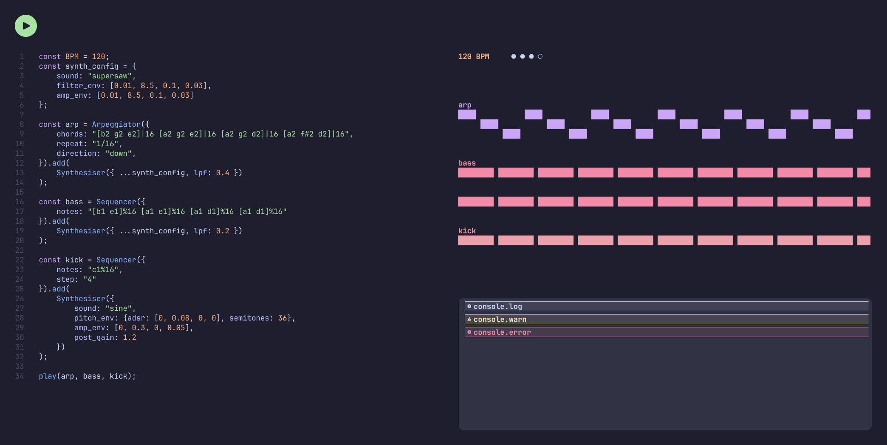

# PRD: beatscript (v0)

**Owner:** Jacob O'Neill
**Status:** Draft

---

## Contents

1. [The Vision](#1-the-vision)
2. [Who's it for?](#2-whos-it-for)
3. [Syntax](#3-syntax)
4. [Tech Choices](#4-tech-choices)
5. [Design](#5-design)

## 1. The Vision

beatscript is a small live code music production tool inspired by [Strudel](https://strudel.cc) for music producers with a passion for software development that prefer a text based minimal workflow.

## 2. Who's it for?

It's mainly for myself, I want to learn how the Web Audio API works, and I think it's a cool project to bring my two passions of music and software engineering together.

## 3. Syntax

The live code editing will use an adaption of the [mini notation](https://tidalcycles.org/docs/reference/mini_notation/) used in Strudel.

### 3.1 Example Project

```js
const synthConfig = {
  sound: "supersaw",
  filterEnvelope: [0.01, 8.5, 0.1, 0.03],
  ampEnvelope: [0.01, 8.5, 0.1, 0.03],
};

const arp = Sequencer({
  notes: "[b2 g2 e2]!16 [a2 g2 e2]!16 [a2 g2 d2]!16 [a2 f#2 d2]!16",
  step: "1/16",
}).add(Synthesiser({ ...synthConfig, lpf: 0.4 }));

const bass = Sequencer({
  notes: "[b1,e1]!8 [a1,e1]!8 [a1,d1]!8 [a1,d1]!8",
  step: "1/8",
}).add(Synthesiser({ ...synthConfig, lpf: 0.2 }));

const kick = Sequencer({
  notes: "c1",
  step: "1/4",
}).add(
  Synthesiser({
    sound: "sine",
    pitchEnvelope: { adsr: [0, 0.08, 0, 0], semitones: 36 },
    ampEnvelope: [0, 0.3, 0, 0.05],
    postGain: 1.2,
  }),
);

play(120, arp, bass, kick);
```

### 3.2 Global Functions

| Function                            | Behaviour                                                                            |
| ----------------------------------- | ------------------------------------------------------------------------------------ |
| `play(bpm: number, ...controllers)` | Sets the playing controllers. Controllers not passed to `play` stop at the next bar. |
| `stop()`                            | Stops all controllers                                                                |

### 3.3 Mini Notation

A `notes` string is a list of elements separated by spaces. When it reaches the end it loops.

| Syntax | Example                 | Meaning                                                                                                                            |
| ------ | ----------------------- | ---------------------------------------------------------------------------------------------------------------------------------- |
| Note   | `c3`, `f#2`, `bb1`      | Note name (a–g), optional `#` or `b`, octave number. `a4` is 440 Hz.                                                               |
| Rest   | `~`                     | Silence for one step.                                                                                                              |
| Chord  | `[b1,e1]`               | Notes separated by commas play together.                                                                                           |
| Group  | `[b2 g2 e2]`            | Notes separated by spaces play in order, one per step.                                                                             |
| Repeat | `c1!4`, `[b2 g2 e2]!16` | Fills _n_ steps with the element, one note or chord per step. A group loops through its notes: `[b2 g2 e2]!4` plays `b2 g2 e2 b2`. |

Unlike Strudel, a group doesn't squeeze into one step: each of its notes takes a full step. Without `!n`, a group plays each of its notes once.

Out of scope for now: nested brackets, and mixing commas and spaces in one group.

### 3.4 Controllers

Controllers decide which notes play and when. They take an options object and return a controller instance. `.add(patch)` attaches the patch (e.g. a `Synthesiser`) that will play the controller's notes.

`step` is the length of one step as a fraction of a bar, and `!n` counts in steps.

#### 3.4.1 `Sequencer(options)`

Plays elements in order, one per step. Chords (`[b1,e1]`) play more than one note at once.

| Option  | Type   | Default  | Description                                                              |
| ------- | ------ | -------- | ------------------------------------------------------------------------ |
| `notes` | string | required | Notes in mini notation ([§3.3](#33-mini-notation))                       |
| `step`  | string | `"1/16"` | Length of one step, as a fraction of a bar. `"1/4"` plays quarter notes. |

### 3.5 Patches

Patches take an options object and create a voice that a controller can then play.

#### 3.5.1 `Synthesiser(options)`

`sound` is required, everything else is optional. An option that isn't set is left out of the voice entirely, except `ampEnvelope`, which always applies so notes don't click.

| `sound`      | Description                           |
| ------------ | ------------------------------------- |
| `"supersaw"` | 7 detuned sawtooth oscillators, mixed |
| `"sine"`     | A single sine oscillator              |

| Option           | Type                                         | Description                                                                                                                                                                                        |
| ---------------- | -------------------------------------------- | -------------------------------------------------------------------------------------------------------------------------------------------------------------------------------------------------- |
| `lpf`            | number (0-1)                                 | Low-pass filter cutoff, mapped exponentially from 20 Hz to 20kHz                                                                                                                                   |
| `hpf`            | number (0-1)                                 | High-pass filter cutoff, same mapping as `lpf`                                                                                                                                                     |
| `filterEnvelope` | number[4]\|{adsr: number[4], amount: number} | Envelope on the lpf cutoff. Either an ADSR array, or `{adsr, amount}` where `amount` (0-1) is how far above the base cutoff the envelope peaks. Default amount `1` (peaks fully open). Needs `lpf` |
| `ampEnvelope`    | number[4]                                    | Envelope on the voice volume. Default `[0.01, 0, 1, 0.05]`: a short fade in and out so notes don't click                                                                                           |
| `pitchEnvelope`  | {adsr: number[4], semitones: number (±48)}   | Envelope on oscillator pitch. Peaks `semitones` above the note and settles to it                                                                                                                   |
| `postGain`       | number (0-4)                                 | Linear gain after the amp envelope                                                                                                                                                                 |

## 4. Tech Choices

| Area                | Choice                                                  |
| ------------------- | ------------------------------------------------------- |
| Language            | TypeScript                                              |
| Front End Framework | Preact (TSX)                                            |
| Build               | Vite                                                    |
| Editor              | CodeJar, Prism, and CodeJar-LineNumbers                 |
| Audio               | Web Audio API                                           |
| Hosting             | Cloudflare Workers static assets, managed with OpenTofu |

## 5. Design


